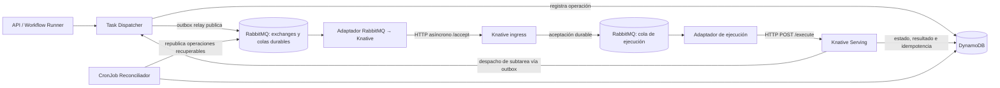
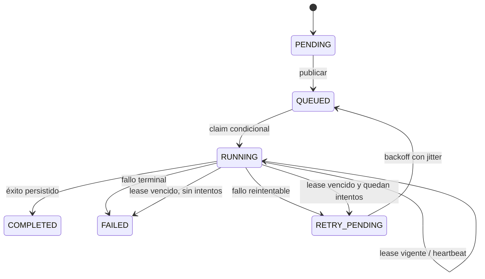
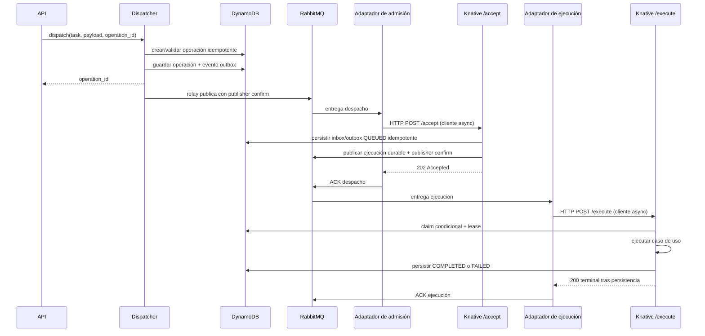

# Plan: migrar workers Celery a Knative

Estado: **propuesta, sin implementar.** Este directorio no gestiona recursos
Knative todavía (no está en `kustomization.yaml`).

## Diseño técnico: ejecución asíncrona con Knative y RabbitMQ

Decisión acordada: **RabbitMQ reemplaza a Redis como broker de tareas** para los
tipos migrados; DynamoDB conserva el estado durable de las operaciones e
idempotencia. Knative Serving ejecuta handlers HTTP escalables y se conservan
los casos de uso y el orden actual de los workflows. Redis puede seguir en uso
para otros propósitos de la aplicación, pero no transportará las tareas
migradas. Esta arquitectura está propuesta, no implementada.

### Arquitectura



| Componente | Responsabilidad |
| --- | --- |
| Task Dispatcher + outbox relay | Crear la operación y su evento de despacho en DynamoDB mediante transacción; el relay publica el outbox en RabbitMQ y lo marca entregado. Devuelve el `operation_id` sin esperar la ejecución. |
| RabbitMQ | Transporte durable con exchanges/colas durables, mensajes persistentes, publisher confirms, acknowledgements manuales, DLQ y políticas de TTL/reintento definidas. |
| Adaptador de admisión | Consumir la cola de despacho y llamar con cliente HTTP asíncrono a Knative `/accept`. Confirma Rabbit solo después del `202` y de que Knative haya persistido la aceptación y el mensaje de ejecución durable. |
| Knative ingress | Validar y deduplicar la operación, escribir el inbox/outbox de ejecución en DynamoDB y publicarlo a la cola durable de ejecución antes de responder `202 Accepted`. No inicia trabajo en background en memoria. |
| Adaptador de ejecución | Consumir la cola de ejecución y llamar con HTTP asíncrono a `/execute`. Mantiene el mensaje sin ACK hasta resultado terminal persistido; limita concurrencia y recupera mensajes con timeout. |
| Knative Serving | Reclamar condicionalmente la operación, ejecutar el caso de uso actual y persistir progreso/resultado en DynamoDB antes de responder. |
| DynamoDB | Fuente durable para estado, resultado, intentos, lease, idempotencia y recuperación. |
| Reconciliador | Encontrar outbox sin publicar, mensajes de ejecución no consumidos y leases vencidos; recuperar mediante actualizaciones condicionales y republicación segura. |

### Contrato y máquina de estados

El dispatcher recibe un tipo de tarea, payload y clave de operación:

```python
dispatcher.dispatch(
    task="review.execute_action",
    payload=payload,
    operation_id=operation_id,
)
```

El contrato lógico del registro incluye:

```json
{
  "operation_id": "uuid",
  "task_type": "review.execute_action",
"status": "QUEUED",
  "attempt": 1,
  "max_attempts": 3,
  "execution_id": "uuid",
  "dispatch_external_id": "uuid",
  "lease_expires_at": 1793920000,
  "updated_at": 1793919900,
  "result": null,
  "error": null
}
```

Estados previstos: `PENDING → QUEUED → RUNNING → COMPLETED | FAILED`; un fallo
reintentable puede pasar por `RETRY_PENDING` antes de volver a `QUEUED`. El claim
de ejecución debe ser condicional por `operation_id`/`execution_id` y lease,
para que entregas repetidas no ejecuten simultáneamente la misma operación.
Los efectos de negocio también deben ser idempotentes: el claim por sí solo no
evita repetir un efecto si el proceso cae después del efecto y antes de guardar
`COMPLETED`.



### Aceptación HTTP, ejecución y confirmación



El dispatcher retorna inmediatamente; no hace `AsyncResult.get()`. El cliente
HTTP asíncrono permite multiplexar I/O, pero no convierte por sí mismo una
ejecución larga en durable ni libera el mensaje Rabbit. Por eso se separan dos
fases: `/accept` responde `202` solo después de guardar la aceptación en
DynamoDB y confirmar la publicación durable en Rabbit; `/execute` responde
terminalmente y el adaptador mantiene el mensaje sin ACK hasta persistir el
resultado. No se lanza trabajo detached en memoria después de responder `202`.
Si se pierde una respuesta, el consumidor reentrega y el endpoint consulta la
operación idempotente en DynamoDB. Los timeouts HTTP deben cubrir `/accept` y
ser compatibles con el límite de duración de `/execute`, ingress y proxy.

La escritura DynamoDB/RabbitMQ no es atómica. Se usa outbox transaccional en
DynamoDB y publisher confirms; si la publicación queda ambigua, el relay puede
publicar duplicados, que se deduplican con `operation_id`/`dispatch_id`. La
aceptación Knative escribe un outbox/inbox durable y publica la ejecución con
confirm antes de devolver `202`. La garantía es entrega **al menos una vez**;
no se promete ejecución exactamente una vez. Configurar quorum queues (si la
plataforma lo ofrece), mensajes persistentes, manual ACK, DLQ, límites de
reentrega y política de redrive. Confirmar versión/operador RabbitMQ y
topología disponibles en OKD durante la fase de plataforma.

### Workflows, reconciliación y configuración inicial

- Los pasos secuenciales actuales del workflow permanecen en el mismo caso de
  uso y en una invocación del handler, salvo que una operación ya se despache
  explícitamente como subtarea. Las subtareas siguen siendo fire-and-forget;
  encolar una subtarea no equivale a esperar su resultado ni a reanudar el caso
  de uso padre.
- La reconciliación pasa de consultar `AsyncResult`/Celery a consultar DynamoDB
  y reparar operaciones/despachos. Para este diseño no debe requerir estado de
  resultados Celery.
- Frecuencia inicial del CronJob reconciliador: 5 segundos, configurable; el
  lease vencido es una señal de ejecución sospechosa, no prueba de que no hubo
  efecto. La recuperación usa claims condicionales, `execution_id` nuevo y
  límites de intentos.
- Configuración inicial propuesta: `containerConcurrency: 1`, `minScale: 0`,
  `maxScale` limitado por capacidad y cuota del proveedor LLM, timeout HTTP de
  hasta 120 segundos, duración objetivo de tareas de 0–50 segundos, 3 intentos
  configurables y backoff exponencial con jitter. Estos valores requieren
  validar límites reales del clúster, ingress, proxy y tareas antes de
  producción.
- RabbitMQ pasa a ser el broker de las tareas migradas; se eliminan
  progresivamente Celery workers y `AsyncResult` para esos tipos. La estrategia
  de convivencia enruta explícitamente por backend y evita que Celery y el
  adaptador consuman la misma operación.

### Garantías objetivo

- El despacho API es asíncrono y retorna `operation_id` sin esperar la tarea.
- Knative escala los handlers según solicitudes HTTP; los adaptadores RabbitMQ
  requieren alta disponibilidad, límites de concurrencia, métricas de lag y
  dimensionamiento propios.
- DynamoDB conserva estado, resultado, idempotencia, leases e intentos.
- La entrega es al menos una vez; escrituras condicionales y efectos
  idempotentes toleran duplicados.
- La reconciliación recupera operaciones abandonadas y publicaciones fallidas.
- RabbitMQ transporta tareas, se elimina `AsyncResult` para los tipos migrados
  y se reutilizan los casos de uso y workflows actuales.

### Plan de implementación

1. Completar las macro tareas de implementación listadas a continuación.
2. Migrar progresivamente con feature flags y rollback por tipo de tarea; retirar
   el consumidor Celery de cada tipo antes de habilitar el nuevo.

### Macro tareas y tareas específicas

Cada macro tarea termina con código, pruebas y criterio de salida verificable.
No migrar el siguiente grupo hasta que el E2E y la reconciliación del grupo
actual pasen en el entorno objetivo.

#### MT-0 — Decisiones de plataforma y contrato

- T0.1 Confirmar RabbitMQ administrado/operado en OKD, versión, TLS, credenciales,
  quorum queues, publisher confirms, DLX/DLQ, límites de tamaño y política de
  persistencia/backup.
- T0.2 Acordar exchanges, routing keys y colas: `dispatch`, `execution`,
  retries por clase de error, DLQ y colas aisladas para `production`, `test`,
  `simulator` y `agent` donde aplique.
- T0.3 Fijar contrato de mensaje versionado: `operation_id`, `dispatch_id`,
  `task_type`, `payload_ref` o payload, `attempt`, `created_at`, `traceparent`.
  Evitar payloads grandes/base64: usar object storage y referencia.
- T0.4 Fijar códigos de aceptación: `202` solo con operación durable y
  publicación confirmada; duplicado ya aceptado también devuelve 202; conflicto
  de mismo id con payload distinto devuelve 409; error antes de persistir/confirmar
  devuelve 5xx para permitir reintento.
- T0.5 Medir duración y tamaño p50/p95/p99 por task; decidir qué tareas exceden
  timeout de Knative y quedan para Job/worker especializado.

**Salida:** ADR aprobado, topología y contratos publicados, límites y timeouts
medidos; no se despliega tráfico productivo.

#### MT-1 — Dominio durable de operaciones e idempotencia

- T1.1 Definir entidad/puerto de operación independiente de Celery: estados,
  transiciones válidas, `attempt`, `max_attempts`, `execution_id`, `lease`,
  heartbeats, `next_attempt_at`, `dispatch_id`, timestamps, error y resultado.
- T1.2 Diseñar claves e índices DynamoDB para idempotency key, operaciones
  activas, outbox pendiente y leases expirados; documentar TTL solo para datos
  terminales retenidos.
- T1.3 Implementar creación idempotente y transición condicional a `RUNNING`;
  rechazar claims concurrentes y detectar idempotency key con payload distinto.
- T1.4 Implementar renovación de lease/heartbeat, finalización condicional y
  fencing por `execution_id` para impedir que una ejecución antigua sobrescriba
  el intento recuperado.
- T1.5 Implementar outbox transaccional de dispatch en la misma transacción
  DynamoDB que crea la operación.
- T1.6 Revisar cada efecto externo de las tareas migrables; añadir clave
  idempotente al destino o registro de efecto/outcome reconciliable. Definir
  compensación/manual review cuando el destino no soporte idempotency keys.
- T1.7 Añadir migraciones/tablas e integración contra DynamoDB Local; cubrir
  concurrencia, duplicados, payload conflictivo, lease vencido, fencing y caída
  entre efecto y estado terminal.

**Salida:** las invariantes de operación e idempotencia pasan pruebas de
concurrencia; no dependen de Celery result backend.

#### MT-2 — RabbitMQ, dispatcher y outbox relay

- T2.1 Implementar factories/configuración de conexión, TLS, credenciales,
  publisher confirms, reconexión, canales y límites; separar configuración por
  ambiente/cola.
- T2.2 Implementar `RabbitMQTaskDispatcher` detrás de los puertos de dispatch
  existentes, con selección por tipo/origen y retorno inmediato de
  `operation_id`.
- T2.3 Implementar relay de outbox con claim condicional/lease, publicación
  persistente y publisher confirm; marcar enviado después del confirm; reintentar
  con backoff y tolerar publicación duplicada.
- T2.4 Declarar topología de exchanges/colas/bindings, DLQ, retry routing,
  expiración y redrive como manifiestos versionados; documentar quién opera
  RabbitMQ y su recuperación.
- T2.5 Añadir métricas/logs de publish confirm, outbox age, queue depth, redelivery,
  DLQ y correlación por `operation_id`; no registrar payload sensible.
- T2.6 Probar broker caído, confirm perdido, publicación duplicada, outbox
  persistente y reinicio del relay.

**Salida:** dispatch durable y observable en un entorno de prueba, sin ejecutar
todavía handlers Knative.

#### MT-3 — Admisión durable y adaptador RabbitMQ→Knative

- T3.1 Implementar adaptador de admisión como Deployment liviano, con consumo
  manual ACK, prefetch acotado, consumer groups/competing consumers, graceful
  shutdown y escalamiento/replicas definido.
- T3.2 Implementar cliente HTTP async con TLS, auth de servicio, timeouts,
  circuit breaker y concurrencia limitada; propagar `traceparent` y
  `operation_id`.
- T3.3 Crear `/accept`: validar schema/tamaño/tipo permitido; escribir de forma
  condicional el inbox y el outbox de ejecución en DynamoDB; publicar a la cola
  `execution` con confirm; responder 202 solo al completar todo lo anterior.
- T3.4 Hacer que redelivery de la misma operación responda 202 sin crear una
  nueva ejecución; discrepancia de hash/payload responde 409; errores previos a
  aceptación responden 5xx.
- T3.5 ACK del mensaje de `dispatch` solo tras 202; en timeout/5xx no ACK y
  aplicar retry/DLQ según clasificación. Manejar el caso de 202 perdido como
  redelivery idempotente.
- T3.6 Implementar métricas de latencia HTTP, 202/409/5xx, retry, inflight,
  redelivery y lag; readiness/liveness y límites de recursos.
- T3.7 Probar caídas entre persistencia de inbox, confirm Rabbit, respuesta 202
  y ACK del mensaje de entrada.

**Salida:** ninguna aceptación se pierde en los puntos de caída probados; el
endpoint no hace trabajo detached en memoria.

#### MT-4 — Ejecución Knative HTTP

- T4.1 Extraer cuerpos de tasks Celery a handlers/casos de uso reutilizables,
  sin introducir imports de infraestructura en `application/`.
- T4.2 Implementar `/execute` por familias de tarea con autenticación interna,
  validación versionada, límites de payload, `operation_id` y `execution_id`.
- T4.3 Implementar claim condicional, lease/heartbeat, contexto de ejecución,
  registro de progreso y estado terminal antes del 2xx.
- T4.4 Definir respuesta a duplicados: COMPLETED devuelve resultado ya guardado;
  RUNNING con lease vigente no inicia otro trabajo; lease expirado requiere claim
  nuevo y fencing; estados terminales no se reabren salvo política explícita.
- T4.5 Configurar Knative `containerConcurrency`, `minScale`, `maxScale`, CPU/RAM,
  timeout, probes, service account, secrets, NetworkPolicy y escalamiento según
  cuotas LLM/DB.
- T4.6 Propagar trazas, auditoría y métricas de tarea; revisar privacidad y
  eliminar señales Celery del camino migrado.
- T4.7 Probar caída del pod durante ejecución, timeout HTTP con resultado
  ambiguo, reintento concurrente y finalización después de perder el cliente.

**Salida:** ejecución recuperable e idempotente contra la cola `execution` en
ambiente de integración.

#### MT-5 — Adaptador de ejecución y recuperación

- T5.1 Implementar consumidor de `execution` con manual ACK y HTTP async a
  `/execute`; conservar el mensaje sin ACK hasta respuesta terminal persistida.
- T5.2 Clasificar resultados: ACK para terminal/duplicado confirmado; retry con
  backoff para fallos transitorios; DLQ para inválidos o intentos agotados.
- T5.3 Implementar heartbeat/progreso que renueve lease mientras el handler
  trabaja y evite recuperar una ejecución viva.
- T5.4 Implementar CronJob reconciliador (intervalo inicial configurable de 5 s)
  para outbox atrasado, operaciones `QUEUED` sin entrega y leases vencidos;
  usar conditional update/fencing antes de reencolar.
- T5.5 Asegurar que el reconciliador no dependa de `AsyncResult`; retirar
  `CeleryAsyncExecutionInspector` solo cuando ningún tipo migrado lo use.
- T5.6 Añadir alertas para lag, edad máxima de outbox/cola, operaciones vencidas,
  DLQ y tasa de reintentos; preparar runbook para replay seguro.
- T5.7 Probar caída de consumidor, Rabbit redelivery, lease vencido, handler
  lento con heartbeat, retry agotado y redrive desde DLQ.

**Salida:** recuperación automática demostrada y ninguna operación queda sin
estado terminal o señal operativa.

#### MT-6 — Migración progresiva por grupos de tareas

- T6.1 Añadir selección de backend por tipo de tarea/origen y feature flag;
  impedir doble publicación durante cambios de backend.
- T6.2 Migrar primero tarea corta, idempotente y sin efectos externos complejos
  (p. ej. limpieza o evaluación acotada); validar cola, estado, métricas y rollback.
- T6.3 Migrar tareas programadas y sustituir entradas Beat por CronJob; apagar
  cada entrada Celery al habilitar su CronJob para evitar doble ejecución.
- T6.4 Migrar imports/datasets y subtareas fire-and-forget una familia a la vez;
  validar estados y contratos de polling de la API.
- T6.5 Migrar el workflow de revisión de alertas con canary por origen/porcentaje;
  comparar latencia, errores, reintentos, tokens y efectos externos contra Celery.
- T6.6 Mantener training y simulador en Celery/Job hasta resolver imagen,
  duración, countdown y requisitos de recursos; no incluirlos por defecto en el
  primer corte.
- T6.7 Retirar tasks/colas Celery migradas y `AsyncResult` asociado solo después
  de drenar, verificar métricas y pasar ventana de rollback.

**Salida:** cada grupo cuenta con evidencia E2E real, métricas comparables,
runbook y rollback ejercitado.

#### MT-7 — Operación, seguridad y cierre

- T7.1 Gestionar RabbitMQ, colas, credenciales y certificados con recursos OKD
  aprobados por plataforma; definir backup/restore, upgrades y capacidad.
- T7.2 Aplicar auth service-to-service al ingreso Knative, NetworkPolicies,
  rotación de secretos y límites de tamaño/rate.
- T7.3 Definir SLOs y dashboards: aceptación, duración, lag, concurrency,
  autoscaling, cold start, errores, retries, DLQ y estado de reconciliación.
- T7.4 Actualizar documentación de despliegue, scheduler, observabilidad,
  respuesta a incidentes y Make targets de operación local si aplica.
- T7.5 Retirar Celery worker/scheduler y dependencias solo cuando no queden
  tareas Celery activas; conservar broker/worker únicamente para familias
  explícitamente fuera del alcance.

**Salida:** producción operable, recuperable, auditada y con procedimiento de
rollback/cierre aprobado.

## Contexto y alternativas evaluadas previamente

Las secciones siguientes documentan el inventario y las alternativas que se
evaluaron antes de acordar RabbitMQ. Para el diseño objetivo, prevalecen las
decisiones y el plan MT-0…MT-7 anteriores: RabbitMQ más adaptadores HTTP y
estado/idempotencia en DynamoDB. No implementar en paralelo la antigua opción
Kafka/Eventing ni conectar dos backends al mismo tipo de tarea.

Contexto: `docs/SCHEDULER_INFRASCRUCTURE.md` evalúa restricciones de Knative
para procesos largos y drenaje. Sus observaciones operativas siguen siendo
relevantes; cualquier valor de minScale, timeout y concurrencia debe validarse
contra la plataforma de destino.

## 1. Qué significa "reemplazar workers por Knative"

Un worker Celery **jala** mensajes de Redis; Knative Serving **escala servicios
HTTP según requests**. No se puede envolver el proceso `celery worker` en un
Knative Service y esperar que escale: Knative no ve la cola, así que no hay
señal de autoscaling ni scale-to-zero útil.

Hay tres caminos, de menor a mayor cambio:

| Opción | Qué cambia | Scale-to-zero | Esfuerzo | Riesgo |
| --- | --- | --- | --- | --- |
| A. KEDA sobre Celery | `ScaledObject` por Deployment, escala por longitud de lista Redis. El código no cambia | Sí | Bajo | Bajo |
| B. Knative Eventing + Serving | Cada task pasa a ser un handler HTTP que recibe CloudEvents; el broker reemplaza la cola | Sí | Alto | Medio-alto |
| C. Híbrido | B solo para tasks cortas y programadas; Celery se queda para workflows largos, training y simulador | Parcial | Medio | Medio |

Estas opciones describen el análisis histórico previo a la decisión de usar
RabbitMQ como broker. La recomendación anterior de KEDA/Celery o Kafka/Eventing
no forma parte del diseño aprobado en esta sección; cualquier reconsideración
requiere actualizar la decisión y las macro tareas antes de implementar.

## 2. Inventario de workloads

Fuente: `src/infrastructure/entrypoint/worker/celery/tasks.py` y
`src/infrastructure/queues/celery/app.py`.

| Task | Disparo | Cola | Candidato Knative |
| --- | --- | --- | --- |
| `workflows.alert_review.run` | API / simulador | `default` | Sí, en fase tardía (larga duración, LLM, autoretry) |
| `workflows.alert_review.escalate_to_analyst`, `document_analyst_decision`, `execute_alert_action` | workflow | `default` | Sí, tras el workflow |
| `metrics.evaluate_alert_reasoning` | workflow | `default` | Sí |
| `async_operations.run` / `reconcile` | API / Beat 60 s | `default` | Sí (reconcile: PingSource) |
| `test_runs.cleanup` | Beat 3600 s | `default` | Sí (PingSource) |
| `metrics.reconcile_alert_rollups` | Beat 02:00 Bogotá | `default` | Sí (PingSource) |
| `object_storage.retention` | Beat 03:00 Bogotá | `default` | Sí (PingSource) |
| `alert_schema.analyze_presence` | Beat 02:30 Bogotá | `default` | Sí (PingSource) |
| `metrics.record_operational_state` | Beat 60 s, `expires` | `default` | Sí, con cuidado: se descarta si no se atiende en su intervalo |
| `datasets.analyze`, `datasets.delete`, `datasets.analyze_fraud_marking` | API | `default` | Sí, medir duración |
| `fraud_review.import_csv`, `analyst_capacity.parse_workbook` | API | `default` | Sí, payload base64 en el mensaje: revisar límite de tamaño del evento |
| `backups.create` | API | `default` | Medir duración; probable Job |
| tasks de CSV test runs | API | `test` | Sí (broker/trigger dedicado, aislado del productivo) |
| `models.train`, `models.preview_features` | API | `model-training` | **No**: imagen pesada (XGBoost/sklearn), `concurrency=1`. Candidato a `Job`, no a Knative Service |
| Tick del simulador | autoprogramado con `countdown` | `event_simulation` (Redis DB 2) | **No** en esta ola: Knative no tiene entrega diferida nativa |
| Celery Beat (scheduler) | proceso único | — | Se reemplaza por PingSources; se elimina el pod |

El MCP y la API ya son servicios HTTP; el MCP puede pasar a Knative Service con
`min-scale: 1` (carga del modelo en memoria), sin cambios de código.

## 3. Por qué la arquitectura lo permite

Los dispatchers viven en `src/infrastructure/queues/celery/*_dispatcher.py` y
`src/infrastructure/workflows/celery/executor.py`; todos llaman
`app.send_task(<nombre>)`. La capa `application/` solo conoce puertos
(`WorkflowExecutor`, `AsyncExecutionInspector`, dispatchers). Por tanto:

- No se toca `application/` ni `domain/`.
- Se agrega un adaptador nuevo bajo `infrastructure/queues/knative/` (o
  `infrastructure/eventing/knative/`) por cada puerto, y se elige con la misma
  variable de entorno que ya existe (`ASYNC_EXECUTOR_BACKEND`, ver
  `async_operation_factory.py`).
- La conmutación por tipo de task permite correr ambos backends en paralelo y
  revertir con un cambio de configmap.

## 4. Diseño alternativo anterior (Kafka/Eventing; no es el objetivo acordado)

```
API ──CloudEvent──▶ Broker (Kafka) ──Trigger(type=…)──▶ Knative Service (handler HTTP)
PingSource (cron) ─────────────────▶ Broker
                                      └─ DeadLetterSink ──▶ servicio de DLQ / alerta
```

- **Broker:** debe ser durable. El broker in-memory **no** sirve (pierde
  mensajes). Kafka (Strimzi / AMQ Streams) es la opción estándar en OpenShift
  Serverless. Redis no es un canal nativo de Knative Eventing.
- **Handler:** un servicio HTTP mínimo (FastAPI/uvicorn o el SDK de CloudEvents)
  que recibe el evento y llama a las mismas funciones de `tasks.py`. La lógica
  de cada task se extrae a funciones reutilizables por ambos backends para no
  duplicarla.
- **Tipos de evento:** `aria.alert.review.requested`, `aria.dataset.analyze`,
  etc., 1 Trigger por tipo con filtro por `type`.
- **Concurrencia:** `containerConcurrency: 1` para workflows con LLM;
  `max-scale` acotado por el límite de rate del proveedor LLM (hoy el límite
  es `--concurrency=10` en un solo pod).
- **Timeouts:** `timeoutSeconds` de la revisión (y el máximo del cluster
  `max-revision-timeout-seconds`) deben cubrir la task más larga que se migre.
- **Retries/DLQ:** `delivery.retry` + `backoffPolicy: exponential` + `deadLetterSink`
  reemplazan `autoretry_for`/`max_retries`. Los casos que hoy usan
  `dont_autoretry_for` (p. ej. `AdversarialFeedbackLimitExceededError`) deben
  responder 2xx con estado de error de dominio, no 5xx, para que Knative no
  reintente.
- **Idempotencia:** hoy `task_acks_late=True` ya implica entrega *al menos una
  vez*; Knative también. Verificar que cada handler migrado sea idempotente
  (hay marcadores `apply_once` y condicionales en rollups, pero hay que
  revisarlo task por task).
- **Programación (Beat):** `PingSource` con cron. Verificar versión del
  operador para soporte de `timezone` (los crons de 02:00/02:30/03:00 son hora
  de Bogotá, `OPERATIONS_TIMEZONE`). Si no hay soporte, expresarlos en UTC
  (Bogotá es UTC−5, sin horario de verano).
- **Observabilidad:** propagar `traceparent` en los CloudEvents y mantener
  `OTEL_ENDPOINT` como único contrato. Hoy `register_audit_signals()` engancha
  señales de Celery; el handler HTTP necesita su equivalente de auditoría y
  de métricas por task. Las reglas de CLAUDE.md (sin `customer_id` ni monto en
  atributos) siguen aplicando.
- **Secretos y config:** reutilizar `aria-worker-main-config` y
  `aria-worker-main-runtime` mediante `envFrom`/`secretKeyRef`, igual que los
  Deployments actuales. La imagen debe cumplir paridad `Dockerfile.*` local y
  `.okd`.
- **Dependencias:** el proyecto Poetry del worker necesita el servidor HTTP /
  SDK CloudEvents. Mantener fuera XGBoost/sklearn/NumPy/joblib.

## 5. Fases

**Fase 0 — Decisión y mediciones (sin cambios en cluster)**
- Confirmar con plataforma que el operador *OpenShift Serverless* (Knative
  Serving + Eventing) está disponible en el namespace, y qué broker durable
  ofrece. Si no existe, el plan B/C no es viable y se va por A.
- Medir en observabilidad: duración p50/p95/p99 y tamaño de payload por task,
  profundidad de cola y concurrencia efectiva. Esto fija timeouts y decide qué
  tasks quedan en Celery.
- Decidir A vs C con esos datos.

**Fase 1 — Plataforma**
- Manifiestos bajo este directorio: `KnativeServing`/`Eventing` (si los
  gestiona el equipo), `Broker`, `DeadLetterSink`, NetworkPolicies y
  ServiceAccount con `artifactory-auth`.
- Agregar al `kustomization.yaml` solo cuando estén validados en un ambiente.

**Fase 2 — Adaptador y handler (feature flag, backend Celery por defecto)**
- Extraer cuerpos de tasks a funciones compartidas.
- Implementar el adaptador Knative de los puertos y el handler HTTP.
- Tests: fakes en memoria por convención del repo; el adaptador va en
  `tests/test_infrastructure/`. Correr `make lint`, `make test-architecture` y
  `GENAI_ENVIRONMENT=test pytest`.

**Fase 3 — Tareas programadas y de bajo riesgo**
- Migrar `test_runs.cleanup`, `object_storage.retention`,
  `metrics.reconcile_alert_rollups`, `alert_schema.analyze_presence`,
  `async_operations.reconcile` a PingSource + handler.
- Criterio: mismos resultados que Celery Beat durante al menos una semana en
  paralelo, **sin** doble ejecución (apagar la entrada de Beat correspondiente
  al encender la PingSource).

**Fase 4 — Tasks disparadas por API**
- Migrar datasets, importaciones CSV, test runs, backups (o convertirlos en
  `Job`).

**Fase 5 — Workflow de revisión de alertas**
- Es el camino crítico de negocio: migrar al final, con canary (porcentaje del
  tráfico o solo simulador), comparando latencia, tasa de error y consumo de
  tokens contra Celery.

**Fase 6 — Retiro**
- Apagar `aria-worker-scheduler` y workers migrados; mantener Redis solo para
  lo que quede en Celery (training, simulador). Actualizar
  `docs/SCHEDULER_INFRASCRUCTURE.md` y `deploy/okd/iac_celery/README.md`.

## 6. Criterios de aceptación

- Ninguna alerta ni operación se pierde o se procesa dos veces de forma
  visible en el flujo migrado (verificar con conteos de rollups y la
  reconciliación nocturna).
- Latencia p95 de revisión de alerta no peor que la actual (valor de partida
  a medir en Fase 0).
- Rollback completo en un cambio de configmap en cada fase.
- Cold start de los servicios con scale-to-zero medido y aceptado; los que no
  lo toleren quedan con `min-scale ≥ 1`.

## 7. Riesgos

| Riesgo | Mitigación |
| --- | --- |
| Timeouts de requests HTTP en tasks largas (LLM, backups) | Medir en Fase 0; dejar en Celery/Job lo que exceda el máximo |
| Cold start en la ruta crítica de alertas | `min-scale: 1` para el handler del workflow |
| Rate limit del proveedor LLM al escalar horizontalmente | `max-scale` y `containerConcurrency` acotados |
| Reintentos duplicados por semántica at-least-once | Revisión de idempotencia por task antes de migrarla |
| Pérdida de tick del simulador | No migrarlo en esta ola |
| Broker no durable o no disponible | Requisito de Fase 0; sin broker durable no se avanza |
| Dos planificadores activos a la vez (Beat + PingSource) | Apagar Beat por entrada al encender la PingSource |

## 8. Preguntas abiertas

1. ¿Está instalado OpenShift Serverless en el cluster de destino y con qué
   versión de Knative?
2. ¿Qué broker durable permite la plataforma (Kafka, otro)?
3. ¿El motivo principal es costo/scale-to-zero (→ A) o estandarización
   (→ C)?
4. ¿Duraciones reales de `workflows.alert_review.run` y `backups.create`?
5. ¿El límite de tamaño de evento del broker admite los payloads base64 de
   los importadores CSV/Excel, o se pasan por object storage y se envía solo
   la referencia?
