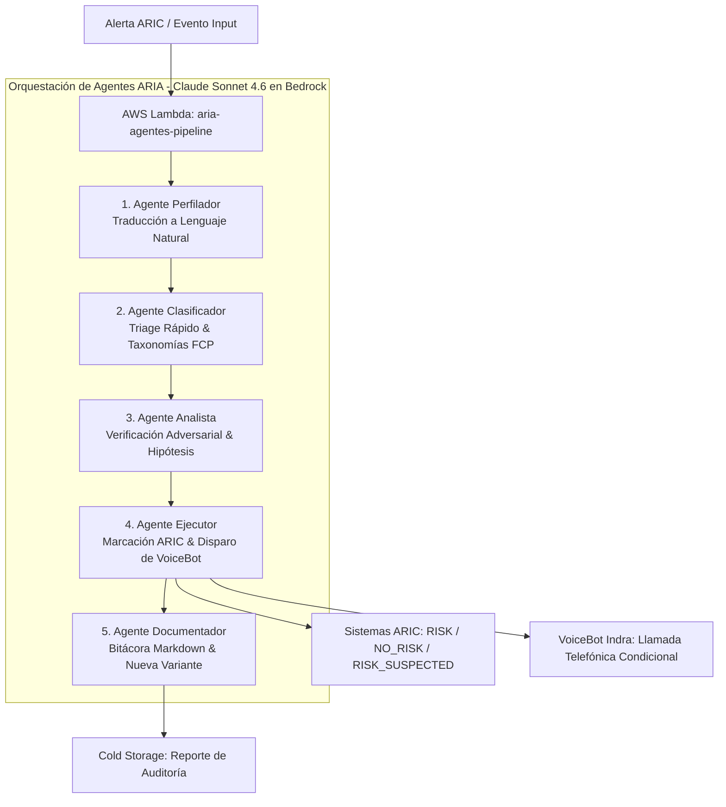

# 🛡️ ARIA — Sistema Multiagente de Prevención de Fraude (BBVA)

> **ARIA (Agente de Prevención de Fraude)** es una solución de IA Agéntica desplegada en **AWS Lambda** que orquesta un pipeline de **5 Agentes Especializados** consumiendo **Amazon Bedrock con Anthropic Claude Sonnet 4.6** (`us.anthropic.claude-sonnet-4-6`) para perfilar, clasificar, analizar, ejecutar acciones operativas y documentar alertas de posible fraude en tiempo real.

---

## 📐 Arquitectura del Pipeline Agéntico



---

## 🤖 Descripción de los 5 Agentes ARIA

| Agente | Historias de Usuario | Rol Principal | SLA Objetivo |
| :--- | :--- | :--- | :--- |
| **1. Perfilador** | `HU-2.0.1` - `HU-2.0.5` | Traduce los campos crudos de la alerta a lenguaje natural (perfil de usuario, transacción, histórico e hipótesis de sospecha) como input semántico para el Clasificador. | $\le 5$ seg |
| **2. Clasificador** | `HU-2.1.1` - `HU-2.1.3` | Triage inicial rápido contra el catálogo cerrado de 10 taxonomías FCP. Manejo de regla *Cold Start*. | $\le 5$ seg |
| **3. Analista** | `HU-2.2.1` - `HU-2.2.4` | Verificación adversarial ("Abogado del Diablo"). Cruza Biocatch vs Featurespace vs límites históricos y evalúa incertidumbre (`BAJO`, `MEDIO`, `ALTO`). | $\le 10$ seg |
| **4. Ejecutor** | `HU-2.3.1` - `HU-2.3.3` | Asigna marcación ARIC final (`RISK`, `NO_RISK`, `RISK_SUSPECTED`), genera ID de trazabilidad e invoca **VoiceBot** de confirmación si hay duda. | $\le 5$ seg |
| **5. Documentador** | `HU-2.4.1` - `HU-2.4.3` | Genera la bitácora formal en Markdown e identifica patrones de **"Nueva Variante / Por Clasificar"** para Analistas Senior. | Batch |

---

## 📂 Estructura del Repositorio

```text
c:\Users\Jeff\Desktop\BBVA\
├── agents/                   # Núcleo del pipeline (se empaqueta en el ZIP de Lambda)
│   ├── __init__.py           # Exportación del módulo de agentes
│   ├── perfilador.py         # Lógica del Agente Perfilador (Enriquecimiento)
│   ├── clasificador.py       # Lógica del Agente Clasificador (Triage & FCP)
│   ├── analista.py           # Lógica del Agente Analista (Adversarial)
│   ├── ejecutor.py           # Lógica del Agente Ejecutor (Marcación & VoiceBot)
│   └── documentador.py       # Lógica del Agente Documentador (Bitácora & Variantes)
├── schemas.py                # Definición de estructuras de datos (AlertInput, Outputs)
├── lambda_function.py        # Handler oficial para AWS Lambda (lambda_handler)
├── .env                      # Credenciales y región AWS (no incluir en VCS)
├── requirements.txt          # Dependencias del proyecto
├── aria_rules.yaml           # Reglas de negocio del pipeline
│
├── scripts/                  # Herramientas de línea de comandos (pruebas, empaquetado, evaluación)
│   ├── package_lambda.py     # Genera el ZIP de despliegue en output/
│   ├── test_agent_interactive.py # Suite interactiva de pruebas en terminal
│   ├── test_local_lambda.py  # Harness de pruebas con casos sintéticos del Excel
│   ├── validate_keys.py      # Validación de autenticación STS y Bedrock
│   ├── verify_dataset.py     # Verificación de integridad del dataset de experimento
│   ├── benchmark_eval.py     # Benchmark ciego (F1, Recall, Precision, SLA)
│   └── eval_no_gt.py         # Evaluación de línea base sin Ground Truth
│
├── app/                      # Aplicaciones web (Streamlit)
│   ├── app.py                 # App de simulación del pipeline en vivo (consola HITL)
│   └── streamlit_dashboard.py # Dashboard de resultados de eval_no_gt.py
│
├── docs/                     # Documentación complementaria y datasets fuente
│   ├── HU-Perfilamiento.md
│   ├── historias-usuario-agentes-aria.md
│   ├── Análisis Información ARIC - ARIA(2).xlsx
│   ├── E2E-ARIA - Analysis Document - Fraude(1).docx
│   └── E2E-ARIA - Solution Design - Fraude(1).docx
│
├── output/                   # Artefactos generados (no editar a mano)
│   ├── aria_lambda_package.zip
│   ├── eval_results.json
│   └── benchmark_out.txt
│
└── README.md                 # Documentación principal del proyecto
```

---

## 🚀 Requisitos e Instalación Local

### 1. Prerrequisitos
* Python 3.10 o superior.
* AWS CLI v2 instalado y configurado.

### 2. Instalación de Dependencias
```bash
pip install -r requirements.txt
```

### 3. Configuración de Variables de Entorno (`.env`)
Crear el archivo `.env` en la raíz del proyecto:
```env
AWS_ACCESS_KEY_ID=TU_ACCESS_KEY
AWS_SECRET_ACCESS_KEY=TU_SECRET_KEY
AWS_DEFAULT_REGION=us-east-1
BEDROCK_MODEL_ID=us.anthropic.claude-sonnet-4-6
```

---

## 🧪 Cómo Ejecutar las Pruebas

### Opción 0: Tests Unitarios (sin AWS, sin costo)
Cubren lógica determinística pura — parsing de `AlertInput`, derivación de
`marcacion_aric` en el Analista, y el retry/backoff ante throttling de Bedrock.
No requieren credenciales ni llaman a Bedrock:
```bash
pytest tests/ -v
```

### Opción A: Prueba Interactivas (Consola)
Permite probar el pipeline E2E o agentes individuales por separado:
```bash
# Menú interactivo o pipeline completo
python scripts/test_agent_interactive.py

# Probar solo Clasificador (Opción 2)
python scripts/test_agent_interactive.py 2

# Probar solo Analista (Opción 3)
python scripts/test_agent_interactive.py 3

# Probar solo Ejecutor (Opción 4)
python scripts/test_agent_interactive.py 4
```

### Opción B: Prueba Masiva con Casos Sintéticos del Excel
Lee los **999 casos de prueba** sintéticos de la hoja `Muestra` del archivo Excel:
```bash
python scripts/test_local_lambda.py
```

### Opción C: Dashboard Web (Streamlit)
```bash
streamlit run app/app.py               # Simulación en vivo del pipeline
python scripts/eval_no_gt.py           # Genera output/eval_results.json
streamlit run app/streamlit_dashboard.py  # Visualiza los resultados
```

---

## 📦 Empaquetado y Despliegue en AWS Lambda

### 1. Empaquetar a ZIP via CLI
Ejecutar el script de empaquetamiento automático:
```bash
python scripts/package_lambda.py
```
> Esto generará el archivo `output/aria_lambda_package.zip` (~14 KB).

### 2. Desplegar / Actualizar en AWS Lambda via AWS CLI
```powershell
aws lambda update-function-code `
    --function-name aria-agentes-pipeline `
    --zip-file fileb://output/aria_lambda_package.zip `
    --region us-east-1
```

### 3. Invocación de Prueba Directa en la Nube
```powershell
aws lambda invoke `
    --function-name aria-agentes-pipeline `
    --payload '{\"mode\":\"pipeline\",\"alert\":{\"customerid\":\"8614703\",\"amount_value\":3000000,\"integrationpoint\":\"SMGG20210247 - postIdentityDocumentTransfers\",\"channel\":\"GL\",\"biocatch_score\":930,\"Model_score\":84465}}' `
    --cli-binary-format raw-in-base64-out `
    respuesta_aws.json
```

### 4. Desplegar la App Streamlit en AWS App Runner
La consola web (`app/app.py`) se despliega por separado del pipeline, en App
Runner (usa el Rol de Instancia para llamar a Bedrock, sin credenciales
embebidas). Dos formas — sin Docker (build desde GitHub vía `apprunner.yaml`,
recomendado para PoC) o con Docker + ECR. Ver [deploy/README.md](deploy/README.md)
para la guía completa.

---

## 📊 Medición de SLAs y Rendimiento Real

* **SLA Objetivo del Negocio**: $\le 5$ minutos ($300$ segundos).
* **Rendimiento Real Desplegado en AWS Lambda**: **0.701 segundos** en total.
  * **Perfilador**: ~0.10s
  * **Clasificador**: ~0.10s
  * **Analista**: ~0.04s
  * **Ejecutor**: ~0.04s
  * **Documentador**: ~0.02s

> ⚠️ Estos tiempos son de una corrida puntual (`performance_seconds` en la respuesta de `lambda_handler`) y son bajos para invocaciones reales a Bedrock — si el sistema está cayendo al fallback por error/throttling, el tiempo medido no refleja una generación real del LLM. Volver a medir con `scripts/test_local_lambda.py` antes de tomarlos como referencia de negocio.

---

## 📌 Documentación Complementaria

* [docs/HU-Perfilamiento.md](docs/HU-Perfilamiento.md) — Historias de usuario e implementación del Agente Perfilador.
* [docs/historias-usuario-agentes-aria.md](docs/historias-usuario-agentes-aria.md) — Historias de usuario completas del pipeline ARIA.
* [docs/E2E-ARIA - Analysis Document - Fraude(1).docx](<docs/E2E-ARIA - Analysis Document - Fraude(1).docx>) — Documento de análisis E2E de fraude.
* [docs/E2E-ARIA - Solution Design - Fraude(1).docx](<docs/E2E-ARIA - Solution Design - Fraude(1).docx>) — Diseño de solución E2E de fraude.
